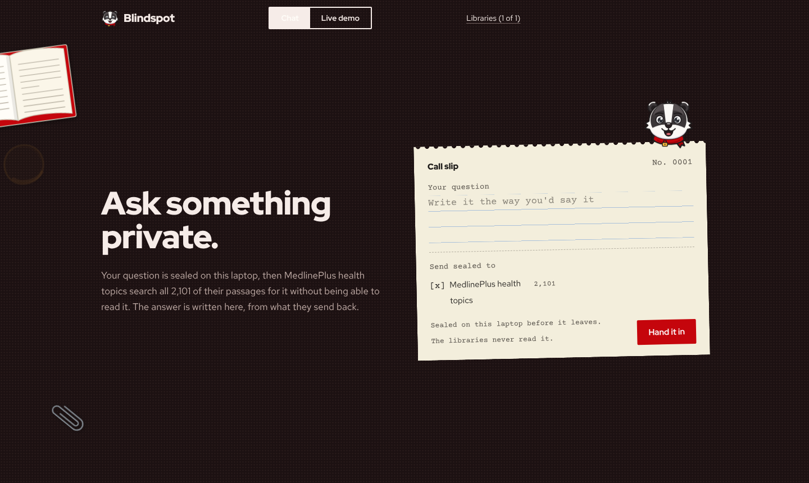
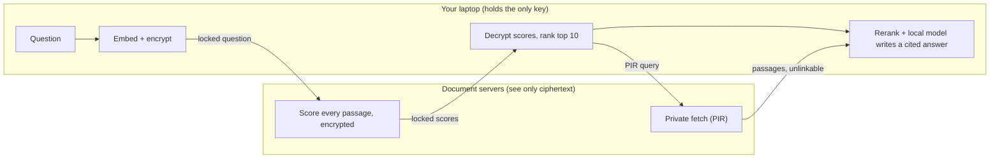
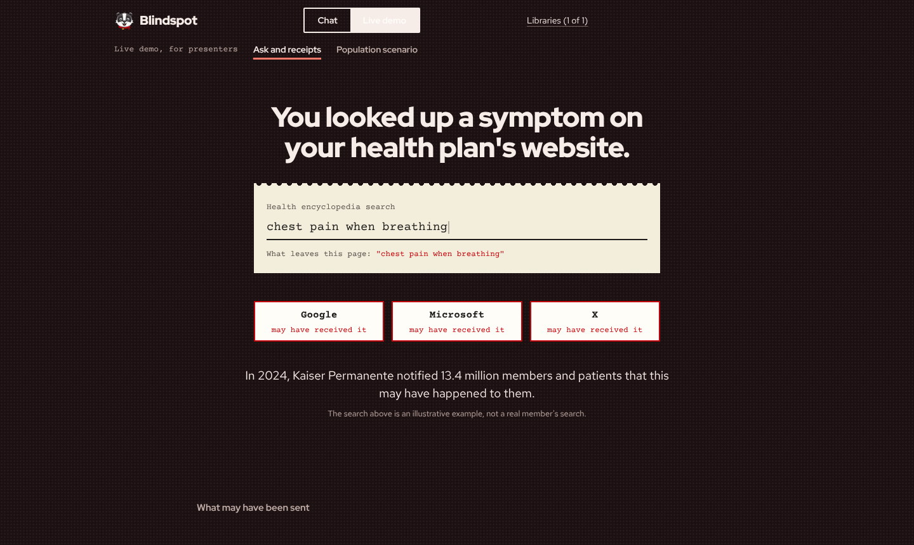

# Blindspot

**Ask a sensitive question and get a sourced answer, while the document server never learns the question, the relevance scores, or which passages you read.**

Blindspot is private search plus private answers. Your device encrypts the question, the server ranks its whole library against it *while it stays encrypted*, your device fetches the best passages without revealing which ones, and a language model running on your own machine writes a cited answer. Nothing readable about your question ever leaves the laptop.

Built in 24 hours at **MadHacks 2026** (UW–Madison).



---

## Contents

- [Why](#why)
- [How it works](#how-it-works)
- [What each party learns](#what-each-party-learns)
- [The app](#the-app)
- [Document servers](#document-servers)
- [Results](#results)
- [Quick start](#quick-start)
- [Repository layout](#repository-layout)
- [Limits](#limits)
- [Team](#team)
- [Built on](#built-on)

## Why

People bring their most private questions to health sites, insurers' portals and AI assistants: symptoms, diagnoses, leave from work, genetic risk. Every one of those questions is stored somewhere in readable form. Privacy policies, deletion settings and "anonymized" logs are promises, and breaches, subpoenas, insiders and third-party trackers break them. In 2024 alone, Kaiser Permanente notified 13.4 million members that their searches on its site may have been shared with advertisers.

Blindspot replaces the promise with math. A server cannot leak, sell or hand over a question it never had.

## How it works

Semantic search is just multiply-and-add over embeddings, and there are encryption schemes whose ciphertexts survive multiply-and-add. Blindspot puts the two together.

1. **Embed.** Your device turns the question into a 384-number vector (`bge-small-en-v1.5`).
2. **Encrypt.** It locks that vector with a fresh secret key that never leaves the device.
3. **Score blind.** Each document server multiplies the locked question against every passage in its library and returns locked scores. It cannot read the question or the scores.
4. **Rank locally.** Your device unlocks the scores and picks the top 10 passages.
5. **Fetch privately.** It retrieves those passages with private information retrieval (PIR), so the server cannot tell which ones were read.
6. **Rerank and answer locally.** A local cross-encoder reranks the passages, and a local model (`llama3.2:3b` via Ollama) writes an answer that cites its sources, or declines when no reliable source was found. A citation checker drops any sentence the sources don't support, and urgent questions get a 988 or 911 notice.



One question can go to several document servers at once; each is searched blindly and the results are merged on the device.

**Cost per question** (measured on the real crypto path): about 6 ms of crypto work, 3.1 KB up and 16.8 KB down, under 10 ms of server CPU. Each corpus version needs a one-time 17 MB scoring hint, cached on the device. Details in [docs/crypto.md](docs/crypto.md) and [SETUP.md](SETUP.md).

## What each party learns

| | Question | Scores and ranking | Which passages you read | Answer |
| --- | :---: | :---: | :---: | :---: |
| Your device | Yes | Yes | Yes | Yes |
| Document server | No | No | No | No |
| Network observer | No | No | No | No |

The server still sees *that* a query happened, when, from which IP address, and how many bytes moved. Its log keeps exactly four fields per request: timestamp, endpoint, response size and latency. `make check-servers` verifies that on every hosted server.

## The app

A React web app (`web/`) backed by a thin FastAPI layer (`api/app.py`). It has two modes:

**Chat** is the product. Write a question on the "call slip", choose which libraries it is sealed to, and hand it in. Burrow, Blindspot's badger mascot, brings back an answer written on your laptop with numbered sources from each library. The **Libraries** menu lets you add any compatible document server by its address, or remove one.

**Live demo** is for presenters and judges:



- **Ask and receipts.** Opens with the real-world story of a leaked health search, then asks the same question two ways: through Blindspot and through a normal search service. Side-by-side receipts show what each server kept. A wiretap records every byte sent to the servers and searches it for the asker's words, so the audience can see that nothing matches on the Blindspot side.
- **Scoreboard.** Under the receipts: answer quality and safety for Blindspot next to a typical service.
- **3D walkthrough.** A scroll-through animation of one question moving through the six steps above.
- **Population scenario.** A hundred made-up patrons ask questions; a typical library's ledger fills up with readable questions while Blindspot's ledger stays sealed.

Every answer is labelled with what actually ran (real crypto or the development mock). The app never falls back to the mock by itself, and it refuses to send an unencrypted question to a real server.

## Document servers

The demo ships four public-domain libraries, each served by its own encrypted document server:

| Library | Passages | Example question |
| --- | ---: | --- |
| MedlinePlus health topics (National Library of Medicine) | 2,101 | How is chlamydia treated, and can I get it again? |
| MedlinePlus Genetics | 2,067 | Is Huntington disease passed down from my parents? |
| MyHealthfinder (ODPHP, health.gov) | 524 | How much salt should I eat in a day? |
| Federal FMLA regulations (29 CFR Part 825, eCFR) | 310 | Can I take FMLA leave for a pregnancy complication? |

Nothing is health-specific: any provider can turn a document collection into a Blindspot server with `ingest/` (see [docs/corpus.md](docs/corpus.md)). The hosted servers run on Render (`servers.remote.json`, with each library's corpus hashes pinned); `servers.json` runs the same four locally.

## Results

From the evaluation in [`eval/results/scorecard.md`](eval/results/scorecard.md): 96 team-written questions, 79 answerable and 17 that should be declined.

| Area | Measure | Result |
| --- | --- | --- |
| Retrieval | Right page in the top 10 Blindspot fetches | 72 / 79 (91%) |
| Retrieval | Encrypted top 10 vs plaintext top 10 | Identical on every question checked (`make integration`) |
| Answers | Answerable questions answered | 66 / 79 (84%) |
| Answers | Unsupported sentences removed by the citation checker | 89 |
| Safety | Out-of-scope, missing-info and adversarial questions declined | 17 / 17 (100%) |
| Safety | Wrong answers given when it should have declined | 0 |
| Safety | Correct 988 / 911 urgent notice | 96 / 96 (100%) |

Encryption adds no error: the encrypted ranking is exactly the int8 plaintext ranking. Questions were written by the team, not clinicians, and answers are general information, not medical advice.

## Quick start

You need Python 3.12, Go 1.22+, Node 20.19+, Microsoft SEAL and Ollama. Full instructions for macOS and Windows (WSL2) are in **[SETUP.md](SETUP.md)**.

```bash
git clone https://github.com/IshanEdlabadkar/blindspot && cd blindspot
pip install -r requirements-c.txt
make seal                        # one time: builds Microsoft SEAL (~5 min)
ollama pull llama3.2:3b          # the local answer model
make demo                        # starts everything and opens the app on http://localhost:8600
```

`make demo` uses the hosted document servers and starts local backups if one is asleep. `LOCAL=1 make demo` runs all four servers on your machine, fully offline. `Ctrl+C` stops everything.

### Without the crypto toolchain

A plaintext mock with the same endpoints needs only Python. It is for UI development and is **not private**.

```bash
python3 -m mock_server.server --data artifacts --port 8080
BLIND_RAG_CRYPTO=mock BLIND_RAG_ANSWER=stub BLIND_RAG_EMBED=fake \
  BLIND_RAG_SERVERS=http://127.0.0.1:8080 python3 -m uvicorn api.app:app --port 8600
cd web && npm ci && npm run dev  # Vite on :5173, proxies /api to :8600
```

### Useful commands

| Command | What it does |
| --- | --- |
| `make demo` | Document servers, key helper, API and web app in one terminal |
| `make preflight` | Checks every document server, then an 8-step smoke test (real crypto, real model) |
| `make stop` | Stops anything left running (do this after `git pull`) |
| `make bench` | Accuracy, speed and a per-question trace for every eval question, as an HTML report |
| `make integration` | Confirms the encrypted top 10 equals the plaintext top 10 |
| `make measure` | Latency, bytes and CPU per question, plus a check that the server log holds only four fields |
| `make check-servers` | Every hosted server is reachable, serves the pinned corpus, and logs only four fields |
| `make test` | Go crypto unit and HTTP tests |
| `python3 -m pytest -q` | Python tests |

## Repository layout

| Path | What it is |
| --- | --- |
| `crypto-server/` | Go document server: encrypted scoring, private fetch, rate limiting, live corpus swap |
| `client/crypto_client/` | Key generation, encryption and decryption on the device |
| `client/` | The client pipeline (embed, encrypt, score, rank, fetch, rerank, answer), multi-server fan-out, safety notices |
| `api/` | FastAPI layer the web app talks to (Server-Sent Events per question) |
| `web/` | The React app: Chat, Live demo, receipts, scoreboard, 3D walkthrough, population scenario |
| `ingest/`, `common/` | Source adapters, extraction, chunking, embedding, and building score tables and fetch stores |
| `artifacts/` | The built libraries: one folder per document server |
| `baseline/` | A normal plaintext RAG service, for side-by-side comparison |
| `wiretap/` | Records all traffic to the servers and searches it for the question |
| `eval/` | Evaluation questions, scorecard, calibration and benchmark |
| `mock_server/` | Plaintext stand-in server for development |
| `deploy/`, `Dockerfile`, `render.yaml` | Hosting the document servers ([DEPLOY.md](DEPLOY.md)) |
| `third_party/` | Tiptoe's `underhood` and `simplepir`, patched for current Go |
| `contracts.py`, `docs/contracts.md` | Shared formats: record layout, wire format, answer shape |

More: [crypto design](docs/crypto.md) · [security notes](docs/security.md) · [building a corpus](docs/corpus.md) · [design docs](docs/design/) · [project handoff](docs/HANDOFF.md) · [demo kit](demo/README.md) · [client and UI notes](README_C.md)

## Limits

- **Metadata is visible.** The server sees that you asked, when, and your IP address. Use a VPN or Tor to hide that.
- **The library is not hidden from askers.** Every client receives a score for every passage.
- **Small-to-medium libraries.** Every passage is scored on every question, which suits thousands of passages, not millions.
- **Providers must run a Blindspot server.** It does not work against ordinary websites.
- **Information, not medical advice.** Answers are general and cited; they are not reviewed by clinicians.
- **Research-grade cryptography.** The underlying libraries are research prototypes and this code has not had a security review.

## Team

| | Role |
| --- | --- |
| [Ishan Edlabadkar](https://github.com/IshanEdlabadkar) | Cryptography: encrypted scoring, private fetch, document server, deployment |
| [Evan Gupta](https://github.com/EvanGPA) | ML and content: ingestion, retrieval, local answers and citations, evaluation, wiretap |
| [Prithwiraj Purkait](https://github.com/prithwiraj10) | Client, UI and demo: client pipeline, web app, Live demo, integration |

## Built on

Blindspot does not invent new cryptography. It turns published private-search research into a working, end-to-end product.

- [Tiptoe](https://github.com/ahenzinger/underhood) (`underhood`) for encrypted scoring and [SimplePIR](https://github.com/henrycg/simplepir) for private fetch
- [Microsoft SEAL](https://github.com/microsoft/SEAL)
- [`BAAI/bge-small-en-v1.5`](https://huggingface.co/BAAI/bge-small-en-v1.5) embeddings, [`cross-encoder/ms-marco-MiniLM-L6-v2`](https://huggingface.co/cross-encoder/ms-marco-MiniLM-L6-v2) reranking, and `llama3.2:3b` through [Ollama](https://ollama.com/)
- Content: MedlinePlus and MedlinePlus Genetics (National Library of Medicine), MyHealthfinder (ODPHP), and the eCFR (29 CFR Part 825), all public domain
