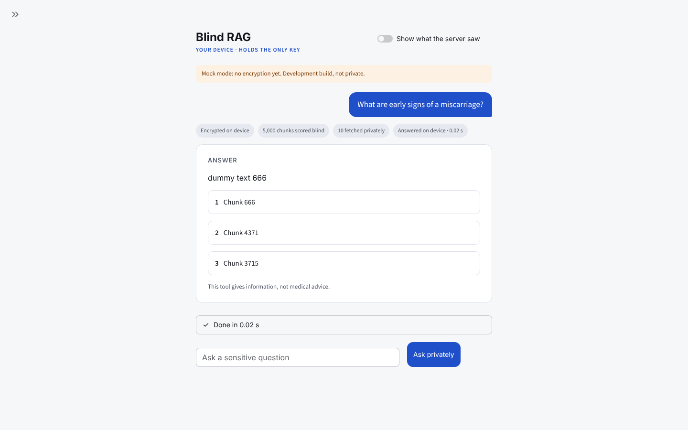
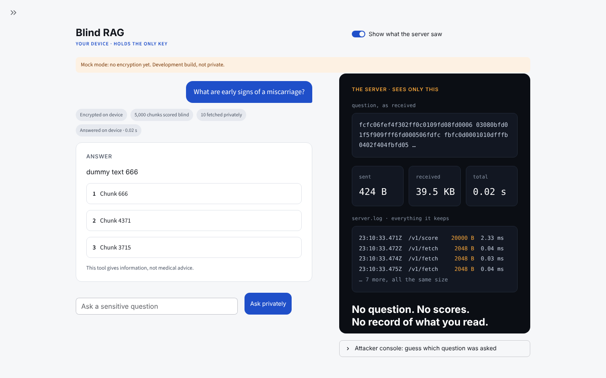
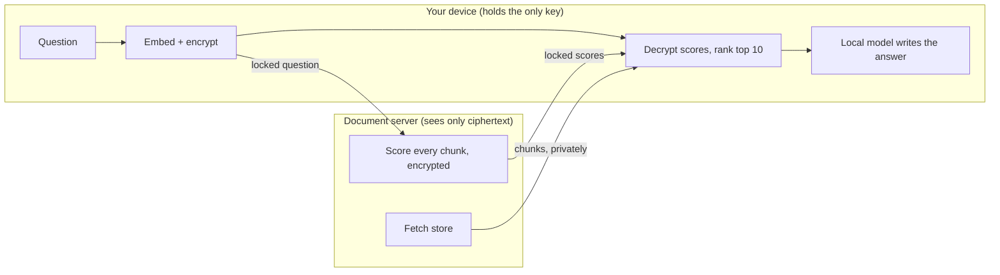

# Blind RAG

**Ask a sensitive question and get a sourced answer, while the server never learns the question, the relevance scores, or which documents you read.**

Blind RAG pairs encrypted search (linearly homomorphic encryption) and private retrieval with a language model that runs on your own device. The server computes on locked data it cannot open. A breach, an insider or a court order can only recover what the server has, and it never had your question.

Built at MadHacks 2026 over a public-domain subset of [MedlinePlus](https://medlineplus.gov/) health topics.

| The asker sees a normal chat | One toggle shows everything the server saw |
| --- | --- |
|  |  |

*Screenshots are from an earlier build running on the development mock. The current app labels every answer with the mode that really ran, and adds Evidence and Who-sees-what tabs.*

## Why

People bring their most private questions to AI and health sites, and every one is stored in readable form. Privacy policies, deletion settings and "anonymized" logs are promises that breaches, subpoenas and policy changes can override. Blind RAG replaces the promise with math: a server cannot leak, sell or hand over a question it never had.

## How it works

Semantic search is multiply-and-add, and there are locks that survive multiply-and-add.

1. **Embed.** Your device turns the question into 384 numbers.
2. **Encrypt.** It locks them with a fresh secret key that never leaves the device.
3. **Score blind.** The server multiplies the locked question against every chunk and returns locked scores. It cannot read them or compare them.
4. **Rank locally.** Your device unlocks the scores and picks the top 10.
5. **Fetch privately.** Your device reads those 10 chunks without the server learning which.
6. **Answer locally.** A local model writes the answer from those passages, with citations, or declines if no reliable source was found.



## What each party learns

| | Question | Scores and ranking | Which chunks you read | Answer |
| --- | --- | --- | --- | --- |
| Your device | Yes | Yes | Yes | Yes |
| Document server | No | No | No | No |
| Network observer | No | No | No | No |

The server still sees that a query happened, when, from which IP address, and how many bytes moved. Its log keeps exactly four fields per request: timestamp, endpoint, response size and latency.

## Results

| Measure | Result | Source |
| --- | --- | --- |
| Corpus | 2,101 chunks from MedlinePlus health topics | `artifacts/manifest.json` |
| Retrieval recall at 10 | 1.00 for both float and int8 embeddings (20 answerable questions) | `eval/results/retrieval.csv` |
| Answers | 19 of 20 answerable questions answered; 5 of 5 unanswerable ones declined | `eval/results/answers.jsonl` |
| Encrypted ranking vs plaintext | Identical top 10 on every question checked | `make integration` |
| Crypto cost per question | About 6 ms, 3.1 KB up, 16.8 KB down | [SETUP.md](SETUP.md), measured by A |
| One-time download per corpus version | 17.2 MB public scoring hint + 4.3 MB fetch store | [SETUP.md](SETUP.md) |
| Local answer generation | About 3 to 6 s warm | B's eval run |

The retrieval and answer figures come from the plaintext baseline. Encryption adds no error, so the int8 ranking is the ranking Blind RAG produces. Full end-to-end numbers on the demo laptop come from `make measure`.

## Quick start

You need Python 3.12, Go 1.22+, Microsoft SEAL and Ollama. Full instructions for Mac and Windows (WSL2) are in **[SETUP.md](SETUP.md)**.

```bash
git clone https://github.com/IshanEdlabadkar/blindspot && cd blindspot
pip install -r requirements-c.txt
make seal                          # one time, builds Microsoft SEAL (~5 min)
brew install ollama && brew services start ollama && ollama pull llama3.2:3b
make demo                          # server + key helper + UI, real crypto
```

`make demo` opens the app in your browser. Ask a question, then flip **Show what the server saw**.

### Without the crypto toolchain

The plaintext mock has the same endpoints and needs only Python. It is for development and is **not private**.

```bash
python3 -m mock_server.server --data artifacts --port 8080
BLIND_RAG_CRYPTO=mock BLIND_RAG_ANSWER=stub BLIND_RAG_EMBED=fake python3 -m streamlit run ui/app.py
```

The app runs the real encrypted path unless you ask for the mock like this, and it labels every answer with what actually ran. It never falls back to the mock by itself.

### Useful commands

| Command | What it does |
| --- | --- |
| `make demo` | Everything in one terminal with real crypto |
| `make demo-compare` | The same, plus a plaintext "normal RAG" server for the side-by-side log contrast |
| `make preflight` | 8-step smoke test before presenting |
| `make stop` | Stop any server or helper left running (do this after `git pull`) |
| `make integration` | Checks the encrypted top 10 equals the plaintext top 10 |
| `make test` | Crypto unit and HTTP tests |
| `make measure` | Latency, bytes and CPU per question, written to `data/measurements.md` |
| `python3 -m pytest -q` | Python tests |

## Repository layout

| Path | What it is | Owner |
| --- | --- | --- |
| `crypto-server/` | Go document server: encrypted scoring and private fetch | A |
| `client/crypto_client/` | Key generation, encryption and decryption on the device | A |
| `third_party/` | Tiptoe's `underhood` and `simplepir`, patched for current Go | A |
| `ingest/`, `common/` | MedlinePlus extraction, chunking, embedding, table building | B |
| `artifacts/` | The built score table, fetch store and manifest | B |
| `client/answer.py` | Local-model answer with citations and safe decline | B |
| `baseline/`, `eval/` | Plaintext RAG for comparison, and the evaluation | B |
| `client/pipeline.py` | The client flow: embed, encrypt, score, rank, fetch, answer | C |
| `ui/` | Streamlit app with the server-view toggle and attacker console | C |
| `mock_server/`, `client/mock_crypto_client.py` | Plaintext stand-ins for development | C |
| `contracts.py` | Shared formats: record layout, wire format, answer shape | all |

**Picking this project up? Read the [detailed handoff](docs/HANDOFF.md) first.** Presenting it? Use the [demo kit](demo/README.md).

More detail: [crypto status and design decisions](docs/crypto.md), [setup](SETUP.md), [remote deployment](DEPLOY.md), [shared contracts](docs/contracts.md), [client and UI notes](README_C.md).

## Limits

- **Metadata is visible.** The server sees that you asked, when, and your IP address. Use a VPN or Tor to hide that.
- **The corpus is not hidden from askers.** Every client receives a score for every chunk.
- **Small corpora only.** Every chunk is scored on every question, which suits thousands of chunks, not millions.
- **A provider must run this server.** It does not work against ordinary websites.
- **Health answers are information, not medical advice.**
- **Research-grade cryptography.** The libraries are research prototypes and this code has not had a security review.

## Built on

Blind RAG does not introduce a new cryptographic technique. It turns published private-search research into a working end-to-end product.

- [Tiptoe](https://github.com/ahenzinger/underhood) (`underhood`) for encrypted scoring, and [SimplePIR](https://github.com/henrycg/simplepir) for private fetch
- [Microsoft SEAL](https://github.com/microsoft/SEAL)
- [`BAAI/bge-small-en-v1.5`](https://huggingface.co/BAAI/bge-small-en-v1.5) embeddings and `llama3.2:3b` through [Ollama](https://ollama.com/)
- Content: MedlinePlus, National Library of Medicine (public-domain health topic summaries)
